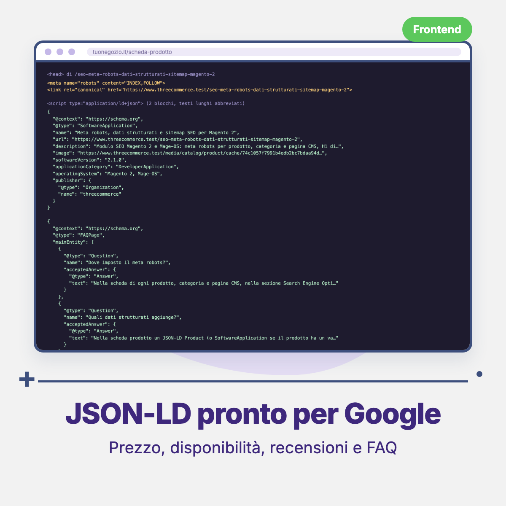

# Threecommerce_Seo: meta robots, structured data and sitemap for Magento 2 / Mage-OS

Magento sets meta robots only at store level, generates no structured data and puts the canonical tag only on products and categories. This module adds the controls that are missing: decide **page by page** what search engines index, add **JSON-LD** to products and keep the **XML sitemap** clean.

**Compatibility:** Magento Open Source / Adobe Commerce 2.4.4 – 2.4.9 · Mage-OS 1.x / 3.x · PHP 8.1 – 8.4 · Themes: Luma, Hyvä, Breeze
**License:** commercial · coming soon

## Features

- **Meta robots** per product, category and CMS page (Index/Noindex, Follow/Nofollow). If the field is empty the general store setting applies.
- **Canonical**: can be removed from a single product or category, and is added to CMS pages as well.
- **Hreflang** between store views in different languages for products, categories and CMS pages, with `x-default` on the default store. No tag is printed if the store has a single language.
- **Custom H1** for categories, different from the name used in menu and breadcrumb.
- **Open Graph image** (`og:image`) for CMS pages.
- **JSON-LD** on the product page: `Product` or `SoftwareApplication` with price, availability and ratings, plus `FAQPage` built from the product FAQ attribute. Off by default.
- **Clean sitemap**: exclude single pages, no internal `catalog/*/view/id/N` URLs, and, if Mageplaza Blog is installed, blog home, posts and categories (excluding NOINDEX ones); the home and blog home get a `lastmod`.
- Values can be set per store view, so every language can differ.
- Tags are written in the page `<head>` and the sitemap is generated on the server: no theme blocks are replaced.

## Requirements

- Magento Open Source / Adobe Commerce 2.4.4+ or Mage-OS
- PHP 8.1 or newer
- Package: `threecommerce/m2-base`
- Optional: Mageplaza Blog for the blog sitemap items

## Availability

This module is **not yet available to buy**. It is a commercial product and is coming soon. To be notified when it is released, or to ask for details, use the [product page](https://www.threecommerce.it/seo-meta-robots-dati-strutturati-sitemap-magento-2?utm_source=github&utm_medium=readme&utm_campaign=magento2-seo) or [get in touch](https://www.threecommerce.it/contatti?utm_source=github&utm_medium=readme&utm_campaign=magento2-seo).

## Configuration

*Stores → Configuration → Threecommerce Plugins → Seo Config*: groups for CMS page, category, product, sitemap and product structured data (enable, version attribute code, FAQ attribute code, `applicationCategory`, `operatingSystem`, organization name). Per-page fields are in the *Search Engine Optimization* section of products, categories and CMS pages.

## Documentation and support

- Product page: [threecommerce.it/seo-meta-robots-dati-strutturati-sitemap-magento-2](https://www.threecommerce.it/seo-meta-robots-dati-strutturati-sitemap-magento-2?utm_source=github&utm_medium=readme&utm_campaign=magento2-seo)
- [Changelog](CHANGELOG.md)
- Support and custom development: [threecommerce.it/contatti](https://www.threecommerce.it/contatti?utm_source=github&utm_medium=readme&utm_campaign=magento2-seo)

---

*This repository is the public showcase of the module. The source code is kept in a private repository.*
